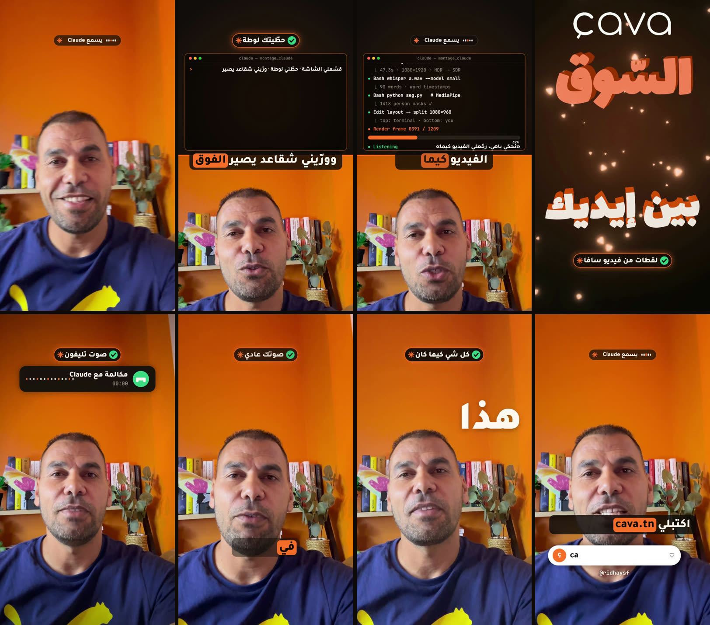
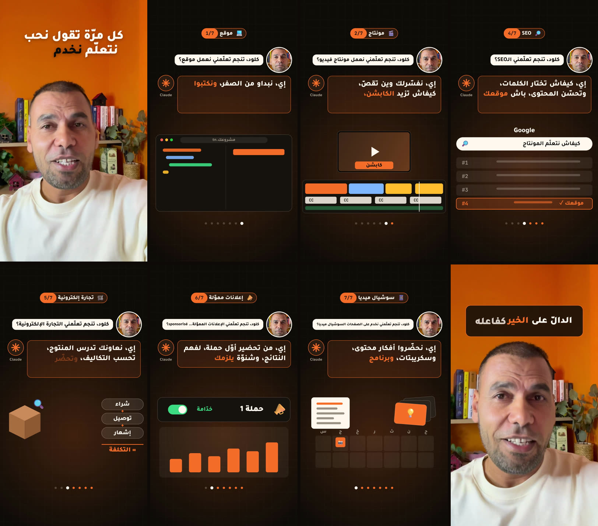

# video-ad-montage — مونتاج ريلز عمودية بـClaude Code (نسخة ويندوز)

مجموعة **5 سكلات** لـ[Claude Code](https://claude.com/claude-code) تمنتج الفيديو بالعربية: ريل من كلام للكاميرا، موشن قرافيكس ثلاثي الأبعاد، بودكاست، مونتاج مقاطع، وكفرات.
هالنسخة مبنية على مشروع **video-ad-editor** (MIT) ومعدّلة باش تخدم مباشرة على **ويندوز**.

<b>جربتها على فيديوهاتي</b>

 
مونتاج بالأوامر الصوتية — أحكي لClaude وهو ينفّذ (كابشن، تقسيم الشاشة، نص ورا الراس، صوت تليفون، مربّع في الوسط…)

 
حوار مع Claude — سؤال مني، جواب بصوت مولّد، وموشن يشرح كل مجال

## شنوّة فيها

| السكل | شنية يعمل |
|---|---|
| `video-ad-editor` | ريل من فيديو كلام: يشيل السكتات، كابشن عربي بتوقيت الكلمة، زوم، موشن قرافيكس، الكلام ورا الشخص |
| `motion-video` | فيلم موشن ثلاثي الأبعاد من نص أو فكرة، بلا تصوير (60 فريم) |
| `podcast-video` | بودكاست بكاميرتين |
| `montage-video` | مونتاج مقاطع على إيقاع الصوت |
| `thumbnail-video` | كفر الريل وثمبنيل |

المحرّك المشترك (السكربتات، الخطوط، مكتبة three.js، بنك الحركات) كلها داخل `video-ad-editor/`.

## تعديلات ويندوز

- كشف **Chrome أو Edge** تلقائياً لرسم المشاهد (`motion/render.js` و`13_collage.js` و`16_render_pod.js`).
- تحويل فيديو آيفون **HDR إلى SDR** بـffmpeg لمّا ما يكون `swiftc` موجود (`03_cut_zoom.py`)، باش تطلع الألوان طبيعية.

## التثبيت (يدوي)

1. نزّل المستودع: `git clone https://github.com/ridhaysf/video-ad-montage`
2. انسخ المجلدات الخمسة **جنب بعضها** إلى `%USERPROFILE%\.claude\skills\` :
   `video-ad-editor` · `motion-video` · `podcast-video` · `montage-video` · `thumbnail-video`
   (السكلات الأربعة الأخرى تقرا المحرّك من `video-ad-editor` المجاور).
3. داخل `video-ad-editor` شغّل `npm install`.
4. التحضير الأول (Node و Python و ffmpeg و Chrome) موصوف في `video-ad-editor/references/onboarding.md`.

بعدها افتح Claude Code وعطيه فيديو: *«منتج هذا المقطع»*.

## الترخيص والشكر

الأساس: **video-ad-editor** من Majed Alzaabi، ترخيص MIT — نص الترخيص محفوظ في [`LICENSE`](LICENSE).
التعديلات على ويندوز والأمثلة والصور في `docs/` من عملي.

---

## Français (résumé)

Collection de **5 skills Claude Code** pour monter des vidéos verticales en arabe (reel parlé, motion 3D, podcast, montage, covers), dans une version **adaptée à Windows** : détection de Chrome/Edge et conversion HDR→SDR par ffmpeg. Base : *video-ad-editor* (licence MIT, conservée dans `LICENSE`). Installation : copier les 5 dossiers côte à côte dans `%USERPROFILE%\.claude\skills\`, puis `npm install` dans `video-ad-editor`. Les images de `docs/` viennent de mes propres vidéos.
